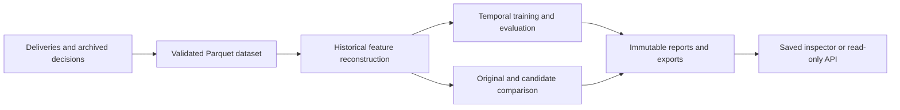

# RiskReplay — ML Engineering for Temporal Fraud Evaluation

A fraud decision can change because the model changed, the rules changed, or the
replay quietly used information that did not exist at the time. RiskReplay makes
those differences inspectable.

It reconstructs historical payment decisions from the evidence available at each
cutoff, compares an archived policy with a candidate, and trains and evaluates
logistic regression and gradient-boosted classifiers on frozen time splits.
Missing evidence stays visible throughout the investigation.

**Python · scikit-learn · Parquet · SQLite · FastAPI · JavaScript**

**[Explore the interactive demo](https://ah682.github.io/riskreplay/)** ·
[Model evidence](https://ah682.github.io/riskreplay/?view=models) ·
[Build checks](https://github.com/ah682/riskreplay/actions)

The demonstration contains **1,800 owned synthetic transactions**. The hosted
version is a read-only saved investigation: filtering, timelines, model evidence
and exports run in the browser. Training, new replays and data imports run locally
in Python.

## The engineering problem

Event time alone is insufficient for historical evaluation. A transaction may
arrive late, a list entry may be added tomorrow, and an outcome may be corrected
weeks later. Replaying today's state against yesterday's decisions introduces
hindsight. Training on labels before they were available introduces leakage.

RiskReplay carries both event time and availability through the pipeline. The
same information boundary governs feature reconstruction, archived decisions and
candidate comparisons. It also separates observed outcomes from immature labels,
historical declines and other unknown outcomes, so a changed action cannot quietly
become a claimed fraud saving.

## Try an investigation

The inspector opens on a ledger of decisions that need attention. A useful first
pass takes about five minutes:

1. Select **`t-monday`**. A deliberately perturbed recorded score produces a
   **mismatched** reconstruction. Inspect the recorded and reconstructed evidence.
2. Filter **Incomplete** and select **`t-after-outage`**. Its policy references an
   intentionally missing model. The report names the missing artifact and leaves
   the reconstructed score and action unavailable.
3. Search **`t-sunday`** and open **Features** and **Timeline**. Tuesday's blocklist
   addition, a late delivery and a correction remain visible as later evidence;
   they cannot enter Sunday's feature state. Repeated deliveries count once.
4. Open **Policy comparison** to trace changed actions through features, models
   and rules. Then open **Model evidence** to inspect held-out metrics, label
   support and review-capacity denominators.

## What the project implements

| Area | Engineering detail |
| --- | --- |
| Temporal data | Immutable identities, event/availability cutoffs, stable sequence ordering, deduplication and correction chains. Explicit coverage gaps and recovery rules. |
| Classical ML | Logistic regression and `HistGradientBoostingClassifier`, plus a fixed rules baseline. Train-only preprocessing, validation tuning and eligibility-gated sigmoid calibration. |
| Evaluation | Frozen chronological 60/20/20 windows, split-specific label cutoffs, AP and PR-AUC reported separately, Brier score, reliability bins, cohorts and fixed 10% review capacity. |
| Reproducibility | Content-addressed datasets and model artifacts, pinned dependencies, fitted-row audits and semantic comparisons across independent runs. |
| Backend and storage | Validated JSONL imports, authoritative Parquet bundles, a rebuildable SQLite index, atomic report publication and a read-only FastAPI inspection API. |
| Investigation UI | Responsive incident ledger, evidence timelines, provenance, staged first-divergence traces and self-contained HTML reports. |

Split boundaries are fixed before filtering missing evidence. An unscoreable test
row keeps its place in the test window and capacity denominator. Model metrics
show the number of mature, scored labels actually supporting them.



An independent forward-only recorder supplies the original feature snapshots;
replay reconstructs them separately. The generator's oracle is stored outside the
normal replay, training, API and reporting paths.

## Run locally

Use **Python 3.12** and `make`:

```bash
git clone https://github.com/ah682/riskreplay.git
cd riskreplay
make demo
```

This creates `.venv`, installs the exact versions in `requirements.lock`, generates
the seeded dataset, trains both classifiers and writes a run under
`var/demo/runs/`. Open the printed **`inspector.html`** path directly in a browser.
The saved inspector needs no server, credentials or network connection. Each run
also includes HTML, JSON and CSV exports.

```bash
make serve       # inspect saved runs at http://127.0.0.1:8765
make pages       # build the static demonstration into _site/
make check       # lint, Python compilation and the automated suite
make reproduce   # compare two clean 600-transaction workflows
```

The Pages build packages the saved demonstration for static hosting. It does not
run Python, fit models or score new transactions in a visitor's browser.

For individual cases and a fresh evaluation:

```bash
.venv/bin/python -m riskreplay replay t-sunday
.venv/bin/python -m riskreplay compare t-tuesday
make evaluate
```

Setup uses exact-version locally installed public distributions when available;
otherwise it downloads the locked packages through `uv` or `pip`. Export optional
settings from [`.env.example`](.env.example); the CLI does not load it implicitly.
`make reset` removes only the marked generated default demo directory.

## Evidence and limits

The [verification record](docs/VERIFICATION.md) contains executed commands, raw
support and the remaining checks. The audited synthetic profiles establish:

| Check | Observed result |
| --- | --- |
| Independent online/offline feature reconstruction | 1,800/1,800 and 7,200/7,200 pristine decisions matched before deliberate defects. |
| Independent metric recomputation | 630 assertions on the 7,200-transaction profile, including capacity, cohorts and reliability bins; saved-estimator predictions verified. |
| Reproducibility | Fresh runs agreed on dataset hashes, model bytes, decision outputs and semantic reports in the pinned runtime. |
| Browser components | 249 assertions across 11 cases at 390/768/1440px, including keyboard interaction and missing-evidence states. |

The default saved run deliberately retains one corrupted score and one missing
model reference to expose **matched**, **mismatched** and **incomplete** states.
The original logging scorer is a deterministic fixture; the evaluated logistic
and boosted classifiers are fitted scikit-learn estimators. This is classical ML
engineering with no LLM dependency.

All data is owned synthetic data. These results do not establish merchant model
quality, production throughput, recovered revenue or a causal fraud-loss effect.
Candidate approvals of historically declined transactions have unknown outcomes.
Feature/model/rule attribution is ordered diagnostic evidence, not causal
attribution. The larger profile exercises calibration with only three positive
calibration labels, so probability calibration remains weakly supported.

The local API has been tested through its ASGI application; live browser-to-server
operation remains a separate verification gate. Permitted merchant records and a
real deployment investigation are also outside the current evidence.

## Read further

- [Contributing](CONTRIBUTING.md) · [Release notes](CHANGELOG.md) · [Independent evaluation protocol](docs/EXTERNAL_EVALUATION.md)
- [Architecture](docs/ARCHITECTURE.md) — module boundaries, artifact identity and failure handling
- [Evaluation protocol](docs/EVALUATION.md) — time splits, label eligibility and metric definitions
- [Data contract](docs/DATA.md) — normalized imports, provenance and permissions
- [Model notes](docs/MODEL_NOTES.md) — estimator and training details
- [Verification](docs/VERIFICATION.md) — measured results and audit evidence
- [Static hosting](docs/PUBLISHING.md) — build and deploy the saved demonstration
- [Limitations](docs/LIMITATIONS.md) · [References](docs/REFERENCES.md)

Project-wide reuse terms are pending an owner decision; no project-wide license
has been granted. Dependency licenses still apply.
